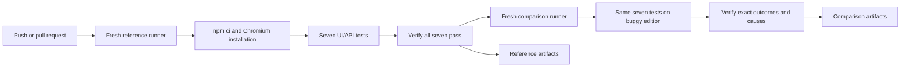

# TK Automation Lab

[](https://github.com/Teka230/tk-automation-lab/actions/workflows/playwright.yml)

Seven Playwright/TypeScript scenarios connect risk-based QA, UI/API contracts, diagnosis and reproducible delivery against the independent Toolshop e-commerce application. Developed with coding-agent assistance; source, decisions and execution evidence are reviewable.

The reference suite must pass **7/7, with zero skips and zero retries**. A separate campaign runs the same seven tests against the buggy edition and verifies exactly **4 passes and 3 known failures**: one seeded functional sorting defect and two API contract differences. A missing expected defect or an additional/different failure makes the campaign fail.

Observed on 2026-10-18: **reference 7/7; comparison 4/7 with all three expected causes verified**. [First hosted run](https://github.com/Teka230/tk-automation-lab/actions/runs/39129143394), source commit `28f2a1e`.

See [observed evidence](docs/EVIDENCE.md), [comparison policy](docs/COMPARISON-POLICY.md), [sorting case](docs/DEFECT-SORT-001.md), [coverage decisions](docs/AUTOMATION-DECISIONS.md) and [source contracts](docs/SOURCE-CONTRACT.md).

## Architecture and authority



Toolshop owns the product data and behavior. Playwright owns raw test results. The policy in `scripts/verify-comparison.mjs` owns campaign acceptance. It does not rewrite raw JSON or JUnit: the comparison artifacts retain three failed tests even when the campaign's expected-outcome verification succeeds.

## Coverage

| Risk | Level | Oracle |
| --- | --- | --- |
| Unusable catalog | API | Nonempty, unique string IDs; usable names/prices |
| Catalog/detail disagreement | API | Same product identity and base price |
| GET/QUERY contract divergence | API | Same criteria produce equivalent catalog results |
| Broken product navigation | UI | Selected card opens its product |
| Incorrect search results | UI | Visible query and matching product names |
| Incorrect price ordering | UI | Visible ascending label produces nondecreasing rendered prices |
| UI/API disagreement | UI/API | API-selected product has the same identity and price in the UI |

The catalog and QUERY checks target reference contracts. The buggy deployment uses numeric IDs and rejects QUERY with 405. Those two failures are classified as contract differences. Only the reversed price ordering is claimed as a confirmed functional defect. The shared UI regression subset is the directly comparable behavior across the two versions.

## Run locally

Use Node 22.23.3 (`.nvmrc`), then:

```bash
npm ci
npx playwright install chromium
npm run test:reference
npm run test:comparison
```

`test:reference` runs Playwright then verifies that all seven expected cases passed. `test:comparison` runs the real buggy suite in a fresh output directory, requires its nonzero exit, and checks every case, attempt, failure cause and diagnostic attachment. It returns success only for the exact known-outcome campaign. No `continue-on-error`, Playwright `test.fail`, retries or target-specific assertion bypasses are used.

The seventeen offline checks in `npm run check:comparison` exercise the verifier itself, including wrong causes, missing cases, skipped tests, retries, vanished defects and unexpected failures. They do not add product scenarios to the seven-test suite.

To inspect local results:

```bash
npm run report
```

The comparison command prints its unique HTML report directory. Open it with `npm run report -- <printed-directory>`; stop an existing report server with Ctrl+C first.

Configuration uses shell environment variables; `.env.example` is documentation and `.env` is not loaded automatically. `SUT_WEB_URL` / `SUT_API_URL` override the reference target. `COMPARISON_WEB_URL` / `COMPARISON_API_URL` must be overridden together for a separate isolated comparison environment. Output roots use `LAB_RESULTS_DIR` / `LAB_REPORT_DIR`.

All hosted requests are read-only. No user, order or shared application data is created or modified.

## CI and evidence

The [Actions workflow](https://github.com/Teka230/tk-automation-lab/actions/workflows/playwright.yml) runs on main pushes, pull requests and manual dispatch. Separate Ubuntu 24.04 jobs install Node from `.nvmrc`, use `npm ci` and install Chromium with its system dependencies. The comparison starts only after the reference gate succeeds. Both jobs upload HTML, JSON, JUnit and available diagnostic attachments, even on failure; retention is 30 days.

Both checks are required on an up-to-date PR before merging to `main`, including for administrators.

Open a workflow run's **Artifacts** section and download `reference-evidence` or `comparison-evidence`. Each archive contains both reports and raw results. Extract it under the repository, locate `index.html`, then serve that report directory with `npm run report -- <directory>`. Select the sorting failure to inspect observed prices, full-page screenshot, video and trace. Artifact download requires a GitHub login; run logs and source are public. Historical run links and exact commits are in the evidence log.

Generated reports, traces, dependencies and auth files are ignored by Git. Evidence summaries and interpretation belong in documentation; CI artifacts own detailed execution evidence.

## Limits and next slice

These are shared hosted deployments with uncontrolled data and unverified application SHAs. The observed bug is intentionally seeded and already known from source; this demonstrates detection and diagnosis, not independent discovery or a controlled single-mutation experiment. Green runs do not establish a statistical stability rate.

Docker isolation, seeded data, authenticated checkout and cleanup remain separate work. Public SUT downtime or contract evolution should fail the gate for investigation. This project links to the [upstream application](https://github.com/testsmith-io/practice-software-testing) and does not redistribute its source; consult its license for application rights.
